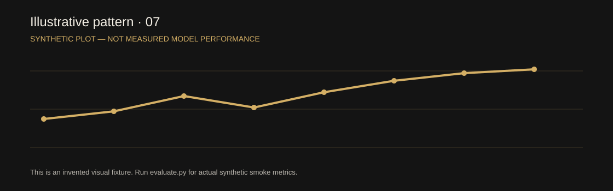

# Trusted Public Health Information Assistant


> **Status:** Demonstration-grade source code using synthetic examples; no real operational deployment, authorized live feed, or independently verified field impact.

**Public need / intended users:** Providing accessible educational links without substituting generated content for clinical judgment. **Audience:** People researching non-urgent public health information.

**Technical evidence:** Health education RAG • refusal • source provenance. Synthetic educational retrieval and urgent-keyword escalation; independent official portal listed for verification.

## Reproducible setup

Run in the root of this standalone project branch:

```bash
pip install -r requirements.txt
python cli.py
uvicorn app.main:app --reload
pytest -q
python cli.py
```

**API endpoint:** `POST /api/v1/analyze`

**Example payload:** [sample_request.json](sample_request.json). The FastAPI interactive schema is at `http://127.0.0.1:8000/docs`.

## Architecture, graphics and reproducibility




- [Workflow source](docs/workflow.mmd) and [detailed architecture](docs/ARCHITECTURE.md).
- [Model card and evaluation plan](docs/MODEL_CARD.md), [threat model](docs/THREAT_MODEL.md).
- Synthetic fixture: `sample_request.json`; run in `cli.py`.
- Shared service: `app/` (model and routing implementation), `tests/` (automated checks), `Dockerfile`, and the local project tests.
- Frontend dashboard: `frontend/index.html`; this requires the API server to function.

## Dataset / source trust

**Planned authorized sources:** Vetted WHO, MoHFW and public-health guidance (NOT ingested). Demonstration data is fabricated; no source licensing or source freshness has been verified through a real ingest.

## Evaluation: do not fabricate results

**Measure:** Groundedness, citation accuracy, urgent escalation recall and multilingual fidelity. The shared forecast modules report baseline and model MAE on chronological holdout when enough observations are provided. Running the evaluation script computes a small synthetic retrieval smoke test. Neither proves live field accuracy.

## Responsible AI constraints

No diagnosis, individualized treatment, or verified urgent triage. Report uncertainty and require human approval for consequential decisions.

**Not yet complete:** licensed production dataset and adapters, professionally reviewed multilanguage support, large independent real-world evaluations, production authentication, secure audit trail, public hosting and domain-expert acceptance. Details: [Acceptance criteria](docs/ACCEPTANCE.md).

[Complete collection](https://github.com/harshakavali81-collab/Enterprise-AI-Intelligence-Platform-Development/tree/main/public-benefit-ai/projects) · [Main repository](https://github.com/harshakavali81-collab/Enterprise-AI-Intelligence-Platform-Development)


## Standalone branch status

This is a **separate Git branch**, not a new GitHub repository. The branch root contains runnable source, fixtures, project graphics, local UI and its own CI. This is a synthetic education/training demonstration, not a production service.

Use `docker compose up --build`, then visit `http://127.0.0.1:5173` and `http://127.0.0.1:8000/docs`.
