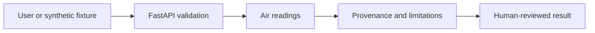

# AI Air Quality and Environmental Health Monitor — architecture

**User / need:** Environment analysts studying pollutant time series. Studying local pollution trends while avoiding fabricated live readings or personal medical conclusions.

**Inputs:** `sample_request.json`; JSON validated by FastAPI and the domain engine.

**Domain method:** Lagged Ridge forecast for PM2.5 synthetic series; chronological holdout versus persistence, input quality checks.

**Pipeline:** User input → API checks → Air readings → structured evidence, caveats, or human-review flag → client.

**Trust boundary:** Live feeds are not connected; all knowledge files are fictional and all real-world inferences are hypothetical.

**Run:** `python projects/air-quality-environmental-health-monitor/cli.py` after installing `requirements.txt` from project collection root.

For a regulated release: perform an approved data-source ingestion design, versioned models, a durable store, rate limits and access control, auditability, monitoring and independent expert review.
