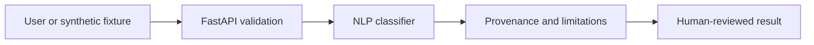

# AI Scam, Phishing and Digital Fraud Awareness Assistant — architecture

**User / need:** Everyday users reviewing suspicious messages. Helping users notice likely phishing signals while avoiding falsely declaring any message safe.

**Inputs:** `sample_request.json`; JSON validated by FastAPI and the domain engine.

**Domain method:** TF-IDF logistic regression trained on tiny labeled synthetic texts; URL parsing without visiting the link.

**Pipeline:** User input → API checks → NLP classifier → structured evidence, caveats, or human-review flag → client.

**Trust boundary:** Live feeds are not connected; all knowledge files are fictional and all real-world inferences are hypothetical.

**Run:** `python projects/scam-phishing-awareness-assistant/cli.py` after installing `requirements.txt` from project collection root.

For a regulated release: perform an approved data-source ingestion design, versioned models, a durable store, rate limits and access control, auditability, monitoring and independent expert review.
