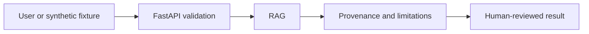

# Multilingual Civic Services and Government Scheme Navigator — architecture

**User / need:** Residents who need accessible public-service information. Understanding application checklists without inventing eligibility rulings or active deadlines.

**Inputs:** `sample_request.json`; JSON validated by FastAPI and the domain engine.

**Domain method:** TF-IDF retrieval over explicitly fictional scheme notes, with a verified government portal link; multilingual embeddings are future work.

**Pipeline:** User input → API checks → RAG → structured evidence, caveats, or human-review flag → client.

**Trust boundary:** Live feeds are not connected; all knowledge files are fictional and all real-world inferences are hypothetical.

**Run:** `python projects/multilingual-civic-services-navigator/cli.py` after installing `requirements.txt` from project collection root.

For a regulated release: perform an approved data-source ingestion design, versioned models, a durable store, rate limits and access control, auditability, monitoring and independent expert review.
