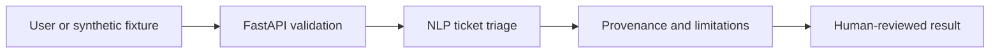

# AI Accessibility and Civic Issue Reporting Platform — architecture

**User / need:** Residents and municipal issue reviewers. Reporting inaccessible infrastructure and making structured queues accessible without publishing personal locations.

**Inputs:** `sample_request.json`; JSON validated by FastAPI and the domain engine.

**Domain method:** TF-IDF logistic text categorization and similarity-based deduplication; human moderation; images and audio are NOT implemented.

**Pipeline:** User input → API checks → NLP ticket triage → structured evidence, caveats, or human-review flag → client.

**Trust boundary:** Live feeds are not connected; all knowledge files are fictional and all real-world inferences are hypothetical.

**Run:** `python projects/accessibility-civic-issue-reporting/cli.py` after installing `requirements.txt` from project collection root.

For a regulated release: perform an approved data-source ingestion design, versioned models, a durable store, rate limits and access control, auditability, monitoring and independent expert review.
