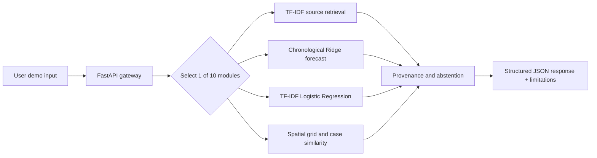

# Architecture and boundaries

No live external fetch, remote LLM, real-time alerts, face recognition, autonomous dispatch, medical diagnosis or government eligibility decisions. The model selection is deliberately conservative and explicitly described by project. SQLite/PostgreSQL, OAuth, monitoring and signed provenance must be added with security review before operational deployment.
