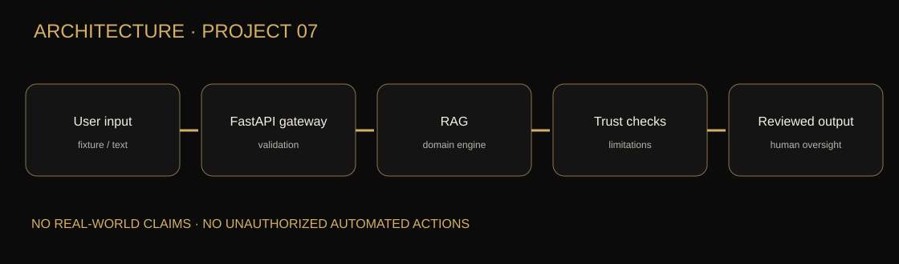

# Multilingual Civic Services and Government Scheme Navigator



> **Status:** Demonstration-grade source code using synthetic examples; no real operational deployment, authorized live feed, or independently verified field impact.

**Public need / intended users:** Understanding application checklists without inventing eligibility rulings or active deadlines. **Audience:** Residents who need accessible public-service information.

**Technical evidence:** RAG • scheme navigation • source citations. TF-IDF retrieval over explicitly fictional scheme notes, with a verified government portal link; multilingual embeddings are future work.

## Reproducible setup

Start at `public-benefit-ai/`:

```bash
pip install -r requirements.txt
python projects/multilingual-civic-services-navigator/cli.py
uvicorn app.main:app --reload
pytest -q
python -m scripts.evaluate
```

**API endpoint:** `POST /api/v1/multilingual-civic-services-navigator/analyze`

**Example payload:** [sample_request.json](sample_request.json). The FastAPI interactive schema is at `http://127.0.0.1:8000/docs`.

## Architecture, graphics and reproducibility




- [Workflow source](docs/workflow.mmd) and [detailed architecture](docs/ARCHITECTURE.md).
- [Model card and evaluation plan](docs/MODEL_CARD.md), [threat model](docs/THREAT_MODEL.md).
- Synthetic fixture: `sample_request.json`; run in `cli.py`.
- Shared service: `../../app/` (model and routing implementation), `../../tests/` (automated checks), `../../Dockerfile`, and `../../scripts/evaluate.py`.
- Frontend dashboard: `../../frontend/index.html`; this requires the API server to function.

## Dataset / source trust

**Planned authorized sources:** Authorized current scheme notices and India.gov.in (NOT ingested). Demonstration data is fabricated; no source licensing or source freshness has been verified through a real ingest.

## Evaluation: do not fabricate results

**Measure:** Recall@K, citation correctness, translated field agreement and link checks. The shared forecast modules report baseline and model MAE on chronological holdout when enough observations are provided. Running the evaluation script computes a small synthetic retrieval smoke test. Neither proves live field accuracy.

## Responsible AI constraints

Never guarantee benefits, grant approvals or fabricate application links. Report uncertainty and require human approval for consequential decisions.

**Not yet complete:** licensed production dataset and adapters, professionally reviewed multilanguage support, large independent real-world evaluations, production authentication, secure audit trail, public hosting and domain-expert acceptance. Details: [Acceptance criteria](../../docs/ACCEPTANCE.md).

[All ten projects](../INDEX.md) · [Main repository](https://github.com/harshakavali81-collab/Enterprise-AI-Intelligence-Platform-Development)
