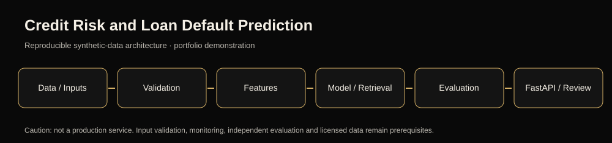
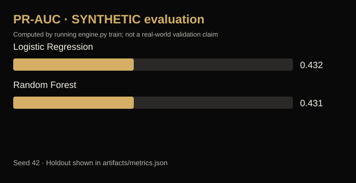

# Credit Risk and Loan Default Prediction






> **Status:** reproducible synthetic-data, local research/portfolio demonstration. The source requirements mention advanced production services; this implementation does **not** claim real-world validation, 24/7 streaming, clinical use, live cloud hosting or third-party system integration.

## Business goal
Prototype repayment-risk research and review.

## Implemented technical work
- Deterministic synthetic (or bundled sample) input generation with controlled seed 42; no client, patient or banking records.
- Leakage-conscious model development and evaluation: Logistic Regression vs Random Forest; PR-AUC, Brier score and calibration.
- Baseline comparison, numerical evaluation output in `artifacts/metrics.json`, and plotted holdout evidence `docs/figures/evaluation.png`.
- Model serialized to `artifacts/model.joblib`, accompanying SHA-256-short manifest and example FastAPI interface.
- Input validation, unit tests, Dockerfile, example GitHub Actions job, data dictionary, model card, and architecture diagram.

## Quick start
```bash
python -m venv .venv
# Activate the environment, then:
pip install -r requirements.txt
python engine.py train
python -m unittest discover -s tests -v
uvicorn api:app --reload
```

- `GET /health`: model readiness
- `POST /predict` with `{"values":[...]}`: numeric feature models
- `GET /recommend?user_id=0&k=5`: recommender project only
- `GET /search?q=Fraud%20alerts`: multilingual search project only
- `/docs`: OpenAPI UI and request examples

## Local CLI
`python engine.py train` produces model, metrics and plots. See `docs/model_card.md`, `docs/data_dictionary.md`, `docs/implementation.md` for model selection, assumptions, limitations and acceptance work.

## Results and scientific honesty
The included synthetic metrics are for software smoke-testing and are **not** comparable to Kaggle/NIH/MVTec/MovieLens real benchmark results. No unauthorized dataset was downloaded, and no model is ready for automated production decisions. A reproducible real-data benchmark and licensed collection are required before performance claims.

## Portfolio summary
Built a reproducible Python ML application demonstrating Logistic Regression vs Random Forest; PR-AUC, Brier score and calibration, an interactive OpenAPI inference interface, modular test coverage, diagrams and visual validation. **Synthetic research prototype; no production claims.**
